<div align="center">

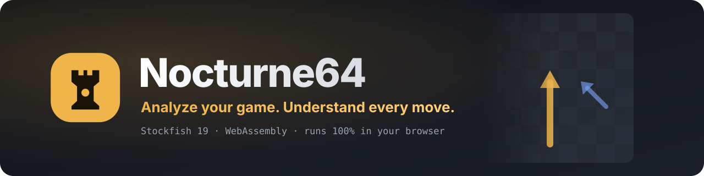

<br />

**A frontend-only chess analysis lab.** Paste a PGN or FEN and get Stockfish 19 analysis, a full game review with move classifications, accuracy, an estimated playing strength and retry puzzles from your own mistakes. Everything runs on your own device: no server, no account, nothing uploaded.

<br />


<br />

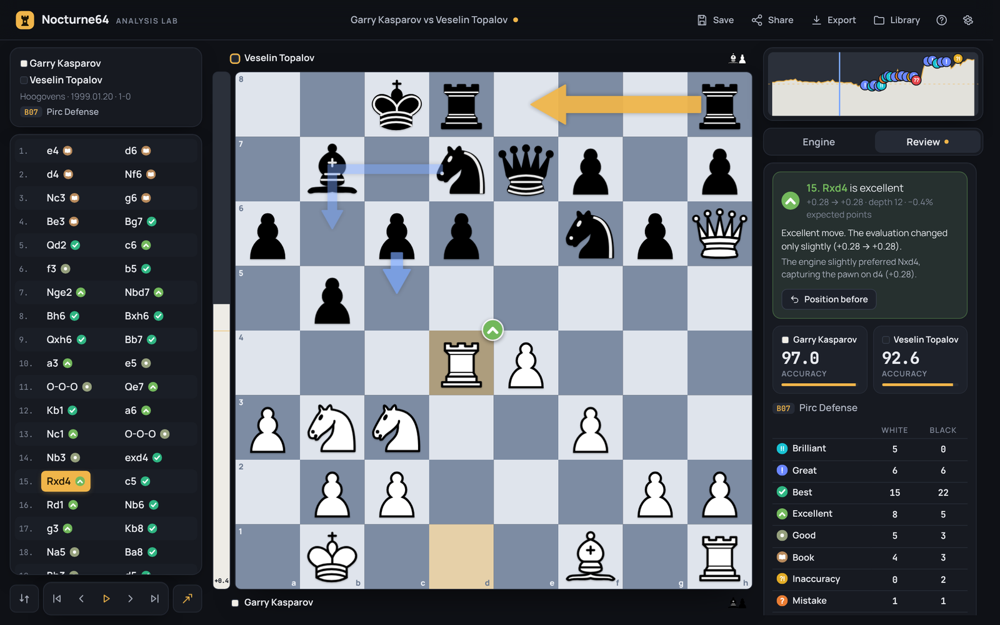

</div>

---

## Contents

- [Highlights](#highlights)
- [See it in action](#see-it-in-action)
- [Quick start](#quick-start)
- [Features in depth](#features-in-depth)
- [How the analysis works](#how-the-analysis-works)
- [Architecture](#architecture)
- [Keyboard shortcuts](#keyboard-shortcuts)
- [Deploying](#deploying)
- [Project structure](#project-structure)
- [Testing](#testing)
- [Privacy](#privacy)
- [Credits & license](#credits--license)

---

## Highlights

<table>
  <tr>
    <td width="33%" valign="top">
      <h3>♟️ Real Stockfish 19</h3>
      The official engine compiled to WebAssembly in a Web Worker. Full-size NNUE network (strongest) or the 1.7 MB lite net, multi-threaded when the browser allows it. Every number is the engine's own; nothing is faked.
    </td>
    <td width="33%" valign="top">
      <h3>🧠 Full game review</h3>
      Brilliant, Great, Best, Excellent, Good, Book, Inaccuracy, Mistake, Miss and Blunder. Each comes with an explanation, the better line, key moments, accuracy by game phase and an estimated rating.
    </td>
    <td width="33%" valign="top">
      <h3>🎯 Learn from mistakes</h3>
      Retry mode turns each of your mistakes, misses and blunders into a puzzle: find the better move, and the engine checks your answer.
    </td>
  </tr>
  <tr>
    <td valign="top">
      <h3>🔒 100% local</h3>
      No backend at all. Analyses, settings and the engine cache live in your browser (IndexedDB). Works offline after the first visit as an installable PWA.
    </td>
    <td valign="top">
      <h3>🔎 Game search</h3>
      Find games by player or "player vs player" on Lichess and Chess.com (public APIs, called from your browser), or in your own imported PGN database.
    </td>
    <td valign="top">
      <h3>✨ Premium board feel</h3>
      Pieces slide smoothly instead of jumping, with original synthesized wooden move and capture sounds. Engine arrows are ranked by line, and the layout works on phones, tablets and desktops.
    </td>
  </tr>
</table>

---

## See it in action

<div align="center">
  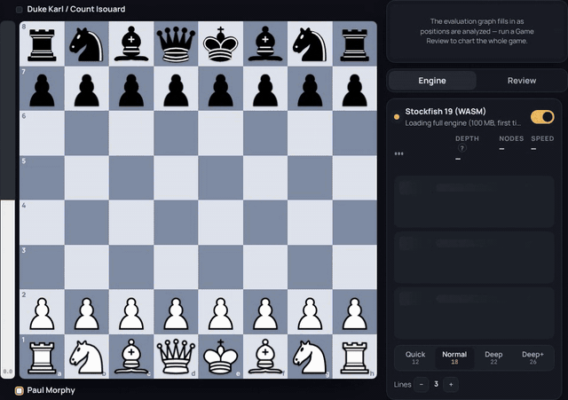
  <br />
  <sub>Stepping through Morphy's Opera Game: smooth piece motion, live Stockfish lines and ranked engine arrows.</sub>
</div>

<br />

| Live engine analysis | Estimated playing strength & phases |
| :---: | :---: |
| 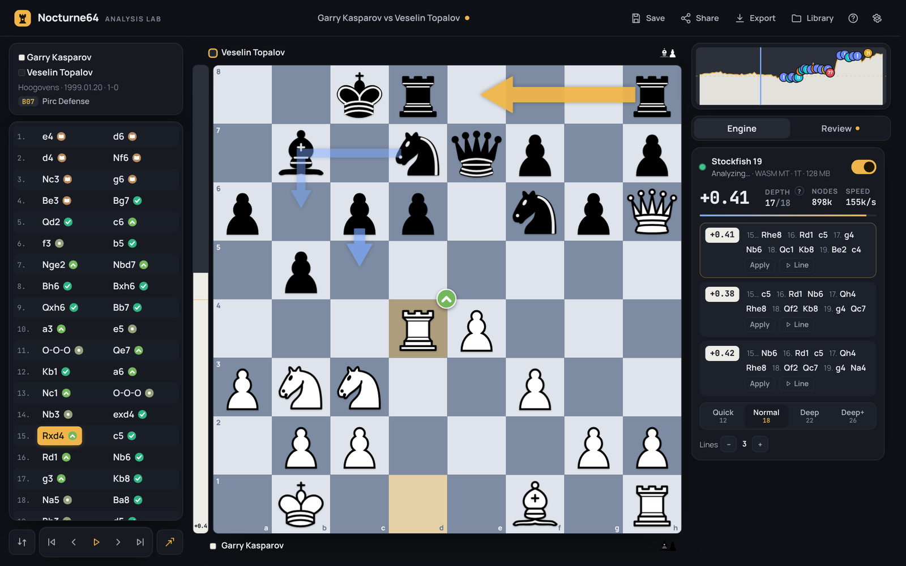 | 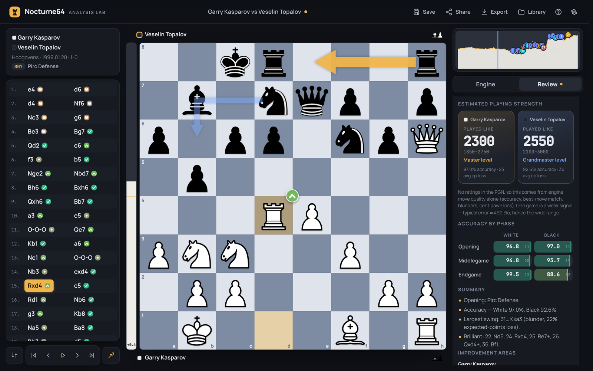 |
| **Home: paste, import or pick a legendary game** | **Light theme** |
| 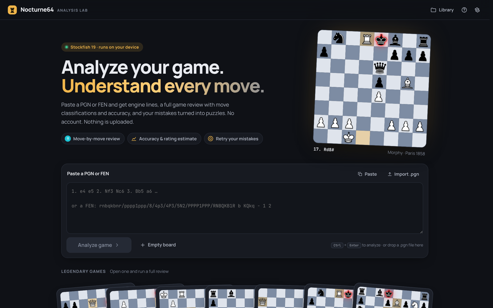 | 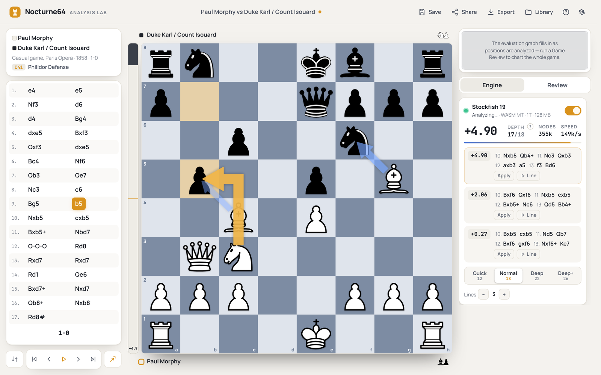 |

<div align="center">

| Tablet (landscape) | Phone | Phone home |
| :---: | :---: | :---: |
| 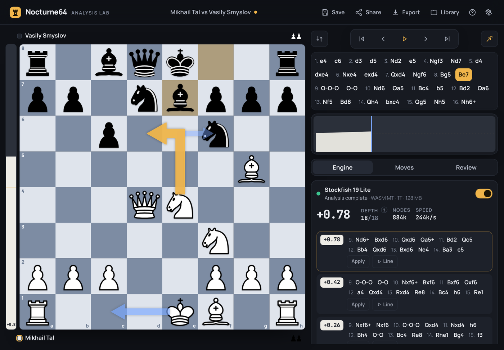 | 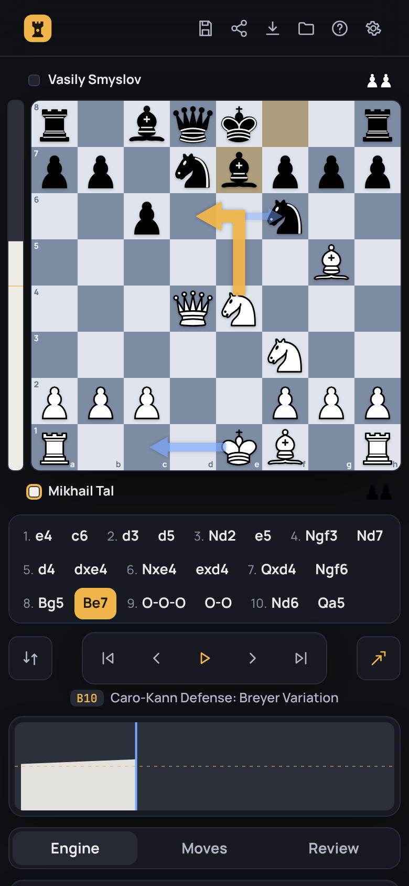 | 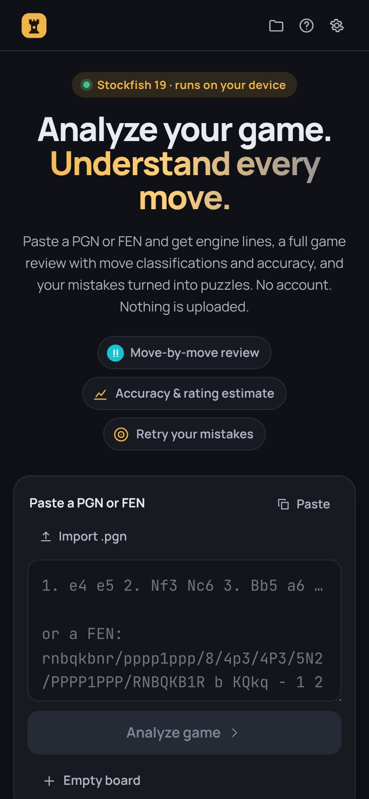 |

</div>

---

## Quick start

> **Requirements:** Node.js 20.19+ (or 22.12+) and npm. No Stockfish download is needed, because the `stockfish` npm package ships the WebAssembly builds.

```bash
git clone https://github.com/Rajdeep582/Chess-Analysis.git
cd Chess-Analysis
npm install        # also copies the Stockfish WASM builds into public/engine
npm run dev        # → http://localhost:5173
```

| Command | What it does |
| --- | --- |
| `npm run dev` | Dev server with the cross-origin isolation headers needed for the multi-threaded engine |
| `npm run build` | Type-checks the app and service worker, then builds the static site into `dist/` |
| `npm run preview` | Serves `dist/` with the same headers |
| `npm test` | Unit + integration tests (runs the real Stockfish WASM in Node) |
| `npm run typecheck` | TypeScript only |
| `npm run build:openings` | Regenerates `public/data/openings.json` and `opening-lines.json` from the lichess-org/chess-openings data |
| `python3 scripts/build-puzzles.py part.zst puzzleTheme.xml` | Regenerates the offline puzzle pack `public/data/puzzles.json` (see the script header) |

---

## Features in depth

### Analysis board
- **Stockfish 19**: depth presets Quick 12 · Normal 18 · Deep 22 · Deep+ 26, plus fixed-time or infinite search.
- **Engine lines**: 1–5 lines (MultiPV). Click any move in a line to jump there, *Apply* plays the first move, *Line* auto-plays the whole line.
- **Ranked arrows**: the best move is a bold gold arrow; the 2nd and 3rd lines are progressively thinner and fainter blue arrows. Knight moves get a proper L-shaped arrow.
- **Board & navigation**: smooth eval bar and evaluation graph; variations with promote/delete; draw your own arrows and circles with right-drag; drag-and-drop or click-to-move with legal-move hints.
- **Material and check**: captured-material counters for both sides; a red king outline on check and a pulsing one on mate.
- **Fast repeat visits**: results are cached in memory and in IndexedDB, so revisiting a position is instant.

### Game review
- **Three phases**: a quick scan of every position, deep re-analysis of the critical moments and every sacrifice, then classification (details below).
- **What you get**:
  - classification badges on the board and in the move list;
  - key moments;
  - plain-language explanations built from the engine lines and material counts;
  - accuracy per player and per phase (opening, middlegame, endgame);
  - an estimated "Played like" rating with a range;
  - a written summary and areas to improve.
- **Retry mistakes**: replay each mistake, miss and blunder as a puzzle, checked by the engine.

### Import, share, export
- **Import**: paste PGN/FEN (auto-detected), import a `.pgn` file or drag and drop it. Every analysis opens in its **own browser tab**.
- **Legendary games**: a deck of famous games to explore, including Carlsen, Fischer, Anand, Tal, Kasparov, Morphy and Anderssen.
- **Game search**: find games on Lichess and Chess.com, or in your own imported PGN database.
- **Library**: save analyses with your variations and settings.
- **Share**: a compressed link (`#a=…`) that recreates the analysis.
- **Export**: PGN with annotations, full JSON, or a printable HTML review report.

### Look & feel
- **Themes**: dark, light or follow the system; five board themes and three piece sets.
- **Sound and motion**:
  - synthesized move, capture, castle, check and mate sounds (original, no audio files);
  - smooth Web-Animations piece motion;
  - "Reduce animation" and "Low power" modes.
- **Layouts**: desktop with three columns; tablet landscape with the board left and tools right; one column on tablet portrait; phone portrait and landscape. Touch targets are at least 40 px.

---

## How the analysis works

### Review pipeline

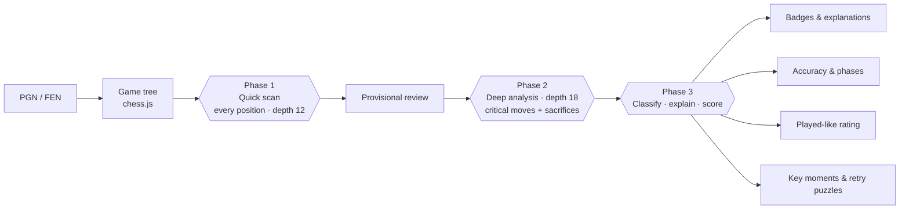

Depths depend on the *Review strength* setting: Fast 10 → 15, Standard 12 → 18, Thorough 14 → 21. Classification runs in short slices that yield to the browser, so the board stays responsive even on long games.

### Win% and expected points

Every evaluation becomes a win probability, using the published Lichess curve:

$$\text{Win\%} = 50 + 50\cdot\left(\frac{2}{1+e^{-0.00368208\cdot cp}}-1\right)$$

When the PGN has rating tags, expected points are also scaled by rating, because a +1.5 position is worth more in a strong player's hands.

### Move classifications

A move's class comes from how many **expected points** it loses compared with the engine's best move. The thresholds follow Chess.com's published ranges and can be changed in the code (`DEFAULT_THRESHOLDS`).

| Class | Rule (expected-points loss) |
| --- | --- |
| **Brilliant** | A real piece sacrifice: at least 2 pawns of material given up by force (checked with a capture search and the engine's line). It must be best or nearly best, leave you not worse, and not happen in a position that was already completely winning. |
| **Great** | The only move that keeps the result bucket (winning, equal or losing), or the move that punishes the opponent's error. |
| **Best** | 0.00, the engine's top choice. |
| **Excellent** | ≤ 0.02 |
| **Good** | ≤ 0.05 |
| **Book** | Position is in the lichess-org/chess-openings database. |
| **Inaccuracy** | ≤ 0.10 |
| **Mistake** | ≤ 0.20 |
| **Miss** | Failed to take advantage of the opponent's mistake. |
| **Blunder** | > 0.20 |

### Accuracy

Accuracy uses the method Lichess documents. Each move's accuracy comes from the Win% it lost:

$$\text{acc} = 103.1668\cdot e^{-0.04354\cdot \Delta\text{Win\%}} - 3.1669 \; (+1)$$

Game accuracy is the average of two numbers: a **volatility-weighted mean**, where sliding windows of Win% standard deviation make sharp moments count more, and the **harmonic mean**, which punishes blunders. The same formula gives accuracy for the opening, middlegame and endgame, which are split Lichess-style.

### Estimated playing strength ("Played like")

Chess.com describes its Game Rating as comparing the quality of your moves with what is expected at your rating level. The formula is not public, and Lichess publishes no such number. Nocturne64 follows the same idea, **calibrated on 748 rated Chess.com player-games** (ratings 100–3300; blitz, rapid and daily) analysed with this app's own engine and formulas.

Per game it measures accuracy, average centipawn loss, best-move match rate, blunder rate, the share of near-perfect moves and mean Win% lost. These combine into one quality score in Elo units, which is then used like this:

| What's in the PGN | Method | Typical error |
| --- | --- | --- |
| Player's own rating | Rating ± how far the move quality sits above or below what that rating normally plays (Chess.com's approach). Averages out to the real rating over many games. | Tracks the rating |
| Only the opponent's rating | Opponent rating + result + quality relative to that level | ≈ 105 Elo |
| No ratings | Move quality alone (one game is a weak signal, hence the wide range) | ≈ 490 Elo |

> Chess.com's exact algorithms (CAPS2, Classification V2, Game Rating) are not public, so results are close but not identical. These are Nocturne64's own heuristics.

---

## Architecture

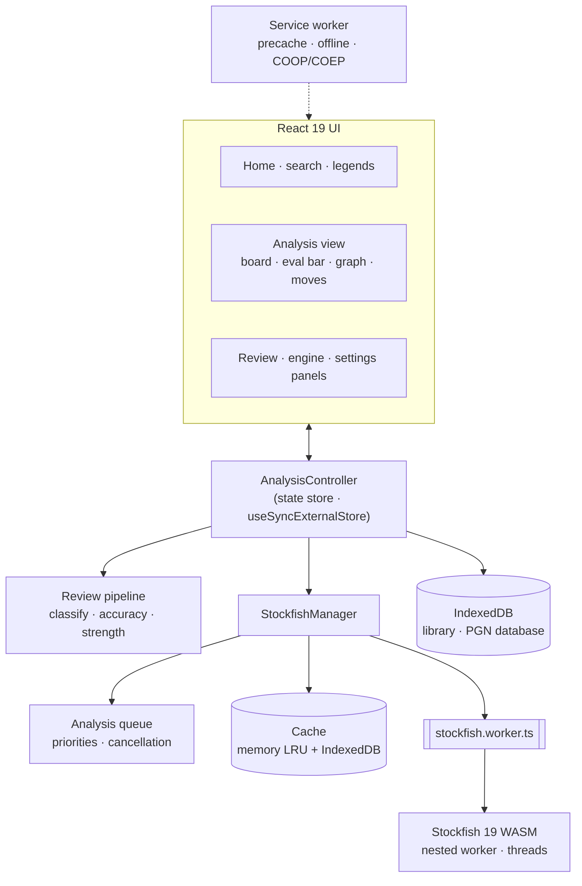

**Engine builds and automatic fallback.** The best build that can run is used. If one fails to load, the next takes over, and engine crashes restart it automatically.

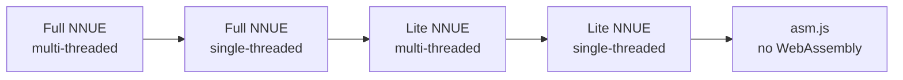

| Build | Size | Default on |
| --- | --- | --- |
| **Max**: Stockfish 19 full NNUE, every CPU thread, 256 MB hash, Thorough review depths | ~100 MB, downloaded once then cached | Optional (one tap) |
| **Lite**: Stockfish 19 Lite NNUE, Standard review depths | 1.7 MB, instant | **Default** on every device |

Switch with the **Lite / Max** toggle at the top of the Review panel (desktop, tablet and phone) or in *Settings → Engine build*.

---

## Keyboard shortcuts

| Key | Action |
| --- | --- |
| <kbd>←</kbd> / <kbd>→</kbd> | Previous / next move |
| <kbd>Home</kbd> / <kbd>End</kbd> | Start / end of the line |
| <kbd>Space</kbd> | Play / pause through moves |
| <kbd>F</kbd> | Flip board |
| <kbd>R</kbd> | Start game review |
| <kbd>A</kbd> | Toggle engine arrows |
| <kbd>E</kbd> | Start / stop engine |
| <kbd>Esc</kbd> | Close dialog / exit retry |
| <kbd>?</kbd> | Help |
| Right-drag | Draw your own arrows and circles |
| <kbd>Alt</kbd> + arrows, <kbd>Alt</kbd> + <kbd>Enter</kbd> | Move a cursor on the board and play moves with the keyboard |

---

## Deploying

`npm run build` produces a fully static `dist/` with relative paths, so it can be hosted anywhere: Netlify, Cloudflare Pages, Vercel, GitHub Pages or Replit (a `.replit` static deployment is included).

**Multi-threaded engine.** Threads need `SharedArrayBuffer`, which requires cross-origin isolation:

```
Cross-Origin-Opener-Policy: same-origin
Cross-Origin-Embedder-Policy: require-corp
```

- The dev and preview servers already send these headers, and `public/_headers` covers Netlify and Cloudflare Pages.
- On hosts that can't set headers (GitHub Pages, Replit static), the bundled service worker adds them. The first visit runs single-threaded; after that, the multi-threaded build is used automatically.

> **Size note:** the two full-NNUE builds are about 99 MB each. They are not committed to git (`public/engine` is generated by `npm install`), and they are not precached by the service worker; they are cached the first time they are used.

---

## Project structure

```text
src/
├── audio/          Synthesized board sounds (Web Audio, rendered once into buffers)
├── chess/          Game tree with variations, PGN parser/exporter, FEN checks, material & capture search
├── components/     Board (pieces, arrows, animation), eval bar, graph, move list/strip,
│                   engine/review/settings panels, home, search, dialogs
├── database/       Lichess / Chess.com search + local PGN database
├── engine/         UCI parser, engine session, worker, manager, priority queue, cache
├── review/         Expected points, classification (brilliant/great/miss), accuracy,
│                   phases, strength estimate, explanations, opening book, 3-phase pipeline
├── sharing/        lz-string share links, printable HTML report
├── state/          AnalysisController, settings, store, legendary games
├── storage/        IndexedDB (library, engine cache, PGN database)
├── styles/         Design tokens, themes, responsive layouts
└── sw.ts           Service worker: precache, offline, cross-origin isolation
scripts/            copy-engine (WASM builds → public/engine), build-openings
tests/              Vitest: chess, engine (real WASM), review, storage, database, board animation
```

---

## Testing

```bash
npm test
```

63 tests cover:
- PGN/FEN parsing and the variation tree;
- the UCI parser and the engine session, run against the **real Stockfish WASM** in Node;
- caching and the analysis queue;
- classification, accuracy, phase split and the strength estimate;
- IndexedDB storage, including corrupt-record handling;
- database search and the legendary-games data;
- the board's piece-pairing logic for animations.

---

## Privacy

- **No backend, no analytics, no account.** All analysis runs on your CPU.
- **Your data stays in your browser.** Saved analyses, settings and the engine cache are kept in IndexedDB and localStorage on your device.
- **The only network requests** are the app's own files and, only when you use game search, the public Lichess and Chess.com APIs called directly from your browser.

---

## Credits & license

**Nocturne64** is released under **GPL-3.0-or-later**; see [`LICENSE`](LICENSE) and [`THIRD_PARTY_NOTICES.md`](THIRD_PARTY_NOTICES.md).

- **[Stockfish](https://github.com/official-stockfish/Stockfish)**: GPL-3.0, by the Stockfish developers.
- **[stockfish.js](https://github.com/nmrugg/stockfish.js)**: WebAssembly builds by Nathan Rugg.
- **Opening names**: [lichess-org/chess-openings](https://github.com/lichess-org/chess-openings), CC0.
- **Piece sets** (from the [lichess-org/lila](https://github.com/lichess-org/lila) repository): Classic — Colin M.L. Burnett, GPLv2+; Merida — Armando Hernandez Marroquin, GPLv2+; Chessnut — Alexis Luengas, Apache 2.0; Staunty, Maestro, Tatiana, Cardinal — sadsnake1, CC BY-NC-SA 4.0; California — Jerry S., CC BY-NC-SA 4.0. Nocturne and Tokens are original.
- **Puzzles**: [Lichess puzzle database](https://database.lichess.org/#puzzles), CC0 (offline pack), and the public [Lichess puzzle API](https://lichess.org/api#tag/Puzzles) (live, by theme).
- **Opening summaries**: [Wikipedia](https://en.wikipedia.org/) REST API, CC BY-SA.
- **"Classic" pieces**: cburnett, GPLv2+.
- **Libraries**: [chess.js](https://github.com/jhlywa/chess.js), React, idb, lz-string, Workbox.
- **Fonts**: Manrope and JetBrains Mono, OFL.
- **Original work**: the logo, UI icons, classification icons, sounds, the "Nocturne" and "Tokens" piece sets, and the board themes are original to this project.

<div align="center">
<br />
<sub>Made with ♟️ by <a href="https://github.com/Rajdeep582">Rajdeep Biswas</a></sub>
</div>
